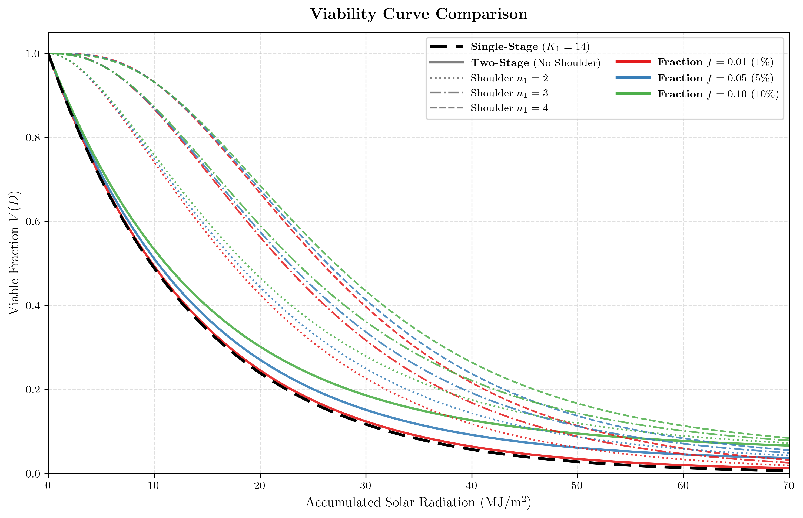
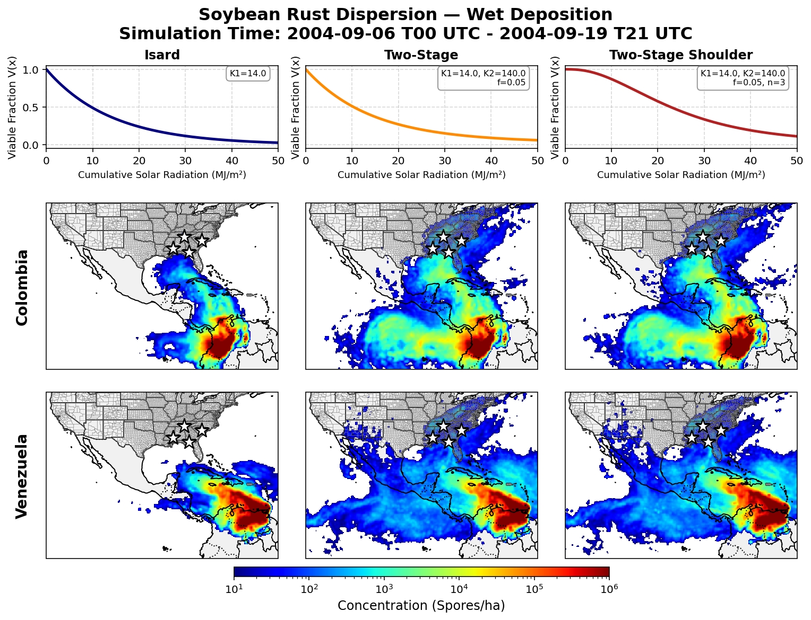

# FLEXPART-VIA

FLEXPART-VIA (FLEXPART-Viability) is a branch off of the FLEXPART 11 model that implements a number of additional viability fits with the aim of better capturing the decay in viability of bio-aerosol particles due to meteorological conditions. 

> [!IMPORTANT]  
> **Research Code / Alpha Status**  
> FLEXPART-VIA was developed as part of a research project on the atmospheric transport and viability of bio-aerosols. It is made publicly available in the hope that it will be useful to other researchers, but it should be considered **Alpha** software with limited testing. 
> 
> While organizational improvements, optimizations, or bug fixes may occur, this repository is intended primarily to support published research and is **not actively maintained or synchronized with future upstream FLEXPART releases**. Use at your own discretion.

FLEXPART v11 Repository: [gitlab.phaidra.org/flexpart](https://gitlab.phaidra.org/flexpart/flexpart)

Documentation for FLEXPART v11: [flexpart.img.univie.ac.at/docs/index.html](https://flexpart.img.univie.ac.at/docs/index.html)  

FLEXPART v11 README: [README](README_FLEXPART.md)

> [!NOTE]
> The authors of this FLEXPART-VIA branch have no affiliation with the creators and maintainers of the main FLEXPART model, though we are grateful for all the work they do to provide and support this tool for the scientific community. Any issues or questions regarding the viability implementations should be directed here rather than to the upstream team.


## Getting started with FLEXPART-VIA

To download FLEXPART-VIA, run the following command in a terminal:

```bash
git clone git@github.com:alb3rtjarvis/flexpart-via.git
```

The model is written in Fortran. It needs to be compiled for the architecture that runs it. Please have a look at the instructions on building FLEXPART available [online](https://flexpart.img.univie.ac.at/docs). 

For the purposes of building FLEXPART-VIA, it can simply be thought of as regular FLEXPART v11 with a compile time flag for generating viability methods. To compile FLEXPART-VIA, follow the instructions to compile FLEXPART v11, and at the make step, simply pass `via=yes` and viability methods will be available. If compiling with `via=no` (the default), performance should be identical to FLEXPART, with `via=yes`, there will be a small performance penalty for the viability computations. A brief summary of the install, assuming the git clone command above was already performed.

- Ensure either `gfortran` (version 8 or higher) or `ifort` is installed (currently, only the `gfortran` makefile is setup, the `ifort` version will be updated soon).
- Ensure the your compiler supports OpenMP and libraries (in particular hdf5) are compiled threadsafe.
- Install the following libraries:
    * ecCodes
    * netCDF
  
  These can be installed with the following commands:
    - In Debian/Ubuntu: `sudo apt install libeccodes-dev libnetcdff `
    - In MacOS + Homebrew: `brew install eccodes netcdf`
       
- Compile FLEXPART-VIA (with viability flag if desired)
  ```bash
  cd flexpart-via/src/
  make -j -f makefile_gfortran via=yes
  ```

See the [Building](https://flexpart.img.univie.ac.at/docs/building.html#download) section of the FLEXPART v11 for more details.

## FLEXPART-VIA Details

As mentioned, FLEXPART-VIA is FLEXPART with additional viability fits implemented. In addition, methods to compute 3D solar radiation have been implemented to obtain more realistic characterizations of viability. We will begin by explaining the implementations and follow up with how to use these in practice. To get right to usage, go to the [Using FLEXPART-VIA](#using-flexpart-via) section.

---

### Model Modifications

FLEXPART simulates the transport of particles, and with each particle is an associated mass (each particle may have X amount of mass, meaning each particle represents Y spores, given each spore weighs X/Y). We define a compile time flag `VIA` that is responsible for turning on/off the viability calculations (when off, things behave exactly as normal FLEXPART). When turned on, the particle derived type gets an additional member `sr_acc` (accumulated solar radiation in MJ), used to calculate the loss of mass due to decline in viability. Then we implement a number of different viability fits and interpolation routines to calculate UV based on surface solar radiation, time of day, top of atmosphere radiation, cloud cover, and particle position (both described below). These routines are integrated into the timemanager module and viability decay, realized as deleted mass, is computed every time step of the model (`lsycntime`).

#### Viability Fits

We incorporate 3 different viability fits, 1 of which has been used in Lagrangian models previously ([Isard et al., 2005](https://doi.org/10.1641/0006-3568(2005)055[0851:POTAPF]2.0.CO;2); [Meyer et al., 2026](https://gmd.copernicus.org/articles/19/4857/2026/)) and 2 that, to the best of our knowledge, have not been used in a Lagrangian model before. All of these fits depend on time and space (3D) UV as UV is the dominant contributor to decay of viable material. Both RH and temperature most likely also contribute to decay of viable material, but for spores like we study here, their effects are poorly understood. While we don’t have exact fits for viability dependence on UV, it is assumed that the dependence takes an exponential-like form. For each of these fits, let $M(t, \mathbf{x}(t))$ represent the mass of a particle at time $t$ and position $\mathbf{x}(t)$, and let $D = D(t, \mathbf{x}(t))$ represent that particle’s accumulated solar radiation.

##### Single-stage Exponential

Arguably the simplest viability fit dependent on 3D UV is a simple exponential (we will refer to this as a single-stage exponential). 

$$M(t+dt) = M(t) \cdot \exp\left(-\frac{D}{k_1}\right)$$

Where $k_1$ is the decay rate. In this fit, it is assumed all spores decay exponentially with the rate governed by the accumulated solar radiation, scaled by the reciprocal of the critical radiation dose. In this fit, all spores are essentially treated equally, and decay begins as soon as any solar radiation is accumulated.
This fit is represented by the dashed black line in Figure 16.

##### Two-stage Exponential

A slightly more sophisticated fit is the two-stage exponential ([Kowalski, 2009](https://doi.org/10.1007/978-3-642-01999-9)),

$$M(t+dt) = M(t) \cdot \left[ (1-f) \cdot \exp\left(-\frac{D}{k_1}\right) + f \cdot \exp\left(-\frac{D}{k_2}\right) \right]$$

Where $k_1$ is the same decay rate as in the single stage (we call it the first stage or fast decay rate here), $k_2$ is the second stage decay rate (or slow decay rate), and $f$ is the resilient fraction. In this fit, some small proportion of the viable mass is treated as more resilient than the rest ($f$ can be some small percentage of the population, say 5%), and this proportion of the mass decays at a much slower rate $k_2$ (perhaps 10x or 20x times slower). This is meant to capture the fact that some spores are thought to be more resilient than the rest, and potentially that spores may coagulate, leading to the inner spores of an aggregation having a higher effective resilience. These fits are represented by the solid red, blue, and green lines (for different resilient fractions) in Figure 16.

##### Two-stage Exponential with Shoulder

Finally we look at the two-stage exponential with shoulder ([Kowalski, 2009](https://doi.org/10.1007/978-3-642-01999-9)),

$$M(t+dt) = M(t) \cdot \left[ (1 - f) \left( 1 - \left(1 - \exp\left(-\frac{D}{k_1}\right)\right)^{n_1} \right) + f \cdot \exp\left(-\frac{D}{k_2}\right) \right]$$

Where $k_1$, $k_2$, and $f$ are all the same as in the two stage, and $n_1$ characterizes the effect of the shoulder. This fit captures all that the two-stage does and adds a shoulder to the fast rate. The shoulder is meant to capture that all spores are resilient to a small amount of solar radiation, and only after the shoulder is overcome does the decay really start. These fits are represented by the dotted, dash-dotted, and dashed (for different shoulder values) red, blue, and green (for different resilient fractions) in Figure 16.


#### Calculating Instantaneous 3D Solar Radiation

All viability fits depend on accumulated solar radiation along particle trajectories, requiring accurate space- and time-dependent instantaneous solar radiation. While Numerical Weather Prediction (NWP) models calculate 3D radiation under the hood to determine atmospheric heating rates, these 3D shortwave flux fields are not archived in standard user-facing outputs. Consequently, most general-purpose Lagrangian models either omit this variable or use overly simplified methods. For instance, the native chemistry module in FLEXPART computes photolysis rates solely as a function of the solar zenith angle, ignoring cloud cover, cloud thickness, and atmospheric attenuation. While standalone Radiative Transfer Models (RTMs) like TUV ([Madronich & Flocke, 1999](https://doi.org/10.1007/978-3-540-69044-3_1)) provide high accuracy, running them inline for millions of particles is computationally prohibitive. 

To evaluate viability across different levels of physical realism, we implement three methods in FLEXPART: two existing approximations that lead to systematic under- or overestimations ([Isard et al., 2005](https://doi.org/10.1641/0006-3568(2005)055[0851:POTAPF]2.0.CO;2); [Meyer et al., 2026](https://gmd.copernicus.org/articles/19/4857/2026/)), and our own hybrid approach.

##### Surface Solar Radiation (Isard)
In the seminal Isard paper on soybean rust ([Isard et al., 2005](https://doi.org/10.1641/0006-3568(2005)055[0851:POTAPF]2.0.CO;2)), they use 2D surface solar radiation ($SSR$) directly as a proxy for the radiation received by particles aloft. While better than a static half-life, this method significantly underestimates the radiation received by particles aloft: a particle flying in clear air high above a thick cloud deck is assigned the same darkened value as the surface, despite being exposed to intense unshielded sunlight. We implement this in FLEXPART as the `SSR` method for comparison.

##### AgPaDS Height-dependent 3D Radiation
In the AgPaDS software ([Meyer et al., 2026](https://gmd.copernicus.org/articles/19/4857/2026/)), they adjust the surface solar radiation using a linear height-scaling factor:

$$SR(t, \mathbf{x}) = SSR(t, \mathbf{x}) + \left[SSR(t, \mathbf{x}) \cdot H \cdot \text{AltScale}\right]$$

Where $SSR$ is the surface solar radiation, $H$ is particle altitude, and $\text{AltScale}$ is a scaling factor (set to 1 in their examples). While this attempts to increase radiation with height, it ignores cloud geometry and the exponential profile of atmospheric mass. Because it scales upward from $SSR$, it still treats air above cloud decks as dark if $SSR$ is low, while also overestimating radiation at higher altitudes under clear skies due to the linear extrapolation. We implement this as the `agpads` method.

##### FLEXPART-VIA Height and Cloud dependent 3D Radiation
In an attempt to find a middle ground between these approximations, we implement a model that accounts for cloud boundaries and particle height while respecting the exponential nature of atmospheric mass. We use ERA5's hybrid sigma-pressure coordinate ($\eta \in [0, 1]$), which directly represents the fraction of atmospheric mass above a given point. Cloud top ($\eta_{TOC}$) and bottom ($\eta_{BOC}$) are extracted for the particle's grid cell, and radiation is calculated across three regimes:

* **No cloud / Above cloud:** When a particle is in clear sky or above the cloud top ($\eta \le \eta_{TOC}$), we apply Beer-Lambert exponential decay ([Campbell & Norman, 1998](https://doi.org/10.1007/978-1-4612-1626-1)) downward from Top-of-Atmosphere radiation ($SR_{TOA}$):

  $$SR = SR_{TOA} \cdot (T_{atm})^\eta$$

  If the particle is above a cloud, we use a fixed clear-sky transmittance $T_{atm} = 0.75$. If there are no clouds in the column, we set $T_{atm} = \min(1.0, SSR / SR_{TOA})$ to dynamically match ERA5 surface conditions at the ground.

* **In cloud:** Inside a cloud layer ($\eta_{TOC} < \eta < \eta_{BOC}$), multiple Mie scattering dominates. Following two-stream approximations for non-absorbing media ([Meador & Weaver, 1980](https://doi.org/10.1175/1520-0469(1980)037<0630:TSATRT>2.0.CO;2)), flux decays diffusively, which we approximate with a linear interpolation between the cloud top ($SR_{TOC}$) and cloud bottom ($SR_{BOC}$):

  $$SR = SR_{TOC} \cdot (1 - f_{\text{depth}}) + SR_{BOC} \cdot f_{\text{depth}}$$

  where $f_{\text{depth}} = \frac{\eta - \eta_{TOC}}{\eta_{BOC} - \eta_{TOC}}$ is the relative fractional depth inside the cloud.

* **Below cloud:** When a particle is below the cloud deck ($\eta \ge \eta_{BOC}$), we take the radiation exiting the cloud base ($SR_{BOC} = SSR / T_{atm}^{1 - \eta_{BOC}}$) and attenuate it across the remaining sub-cloud air mass:

  $$SR = SR_{BOC} \cdot (T_{atm})^{\eta - \eta_{BOC}}$$

We refer to this implementation as the `FLEX-VIA` method.

##### Caveats and Limitations
This approximation is far from perfect. There are a number of simplifications made to reduce the computational cost, keep the implementation relatively simple and dependent only on ERA5 variables already needed by FLEXPART. This method has yet to be tested against high fidelity RTMs. The point was largely to improve the realism of the accumulated UV profile from what was done in previous attempts to compute UV-dependent viability. With that in mind, we note that this approach does not differ between different types of clouds; all are treated the same. In addition, we used the fixed clear-sky transmittance when a particle is above or below a cloud, which neglects various factors determining the true clear-sky attenuation.

#### Comparison of Fits



---

### Using FLEXPART-VIA

Again, consult the FLEXPART docs for details on setting up simulations (see [Configuration](https://flexpart.img.univie.ac.at/docs/configuration.html)). FLEXPART-VIA simply adds a number of extra parameters and flags to be set in the COMMAND file. These are listed below with their possible values.

- `VIABILITY_FIT`: Determines which viability method is used. Valid values:
    * `0`: Constant decay Exponential; this is what FLEXPART natively implements, added for comparison and debugging
    * `1`: [Single-Stage Exponential](#single-stage-exponential) (default)
    * `2`: [Two-stage Exponential](#two-stage-exponential)
    * `3`: [Two-stage Exponential with Shoulder](#two-stage-exponential-with-shoulder)

- `INTERP_VIA_METHOD`:
    * `0`: No UV interp is performed, this should be set if viability is not being calculated
    * `1`: [Surface Solar Radiation (SSR)](#surface-solar-radiation-(isard)); this uses surface solar radiation as a proxy for 3D solar radiation (what was used in the Isard paper) (default)
    * `2`: [AgPaDS method](#agpads-height-dependent-3d-radiation)
    * `3`: [FLEX-VIA method](#flexpart-via-height-and-cloud-dependent-3d-radiation)
    * `uint`: Set to any positive int if using `VIABILITY_FIT = 0`, then: Constant exponential per/hr decay rate with value `real(INTERP_VIA_METHOD) / 1000.0`

## Example

Below we show an example of resulting wet deposition pattern using the various fits. The historic 2004 soybean rust case is used as a demonstration.




